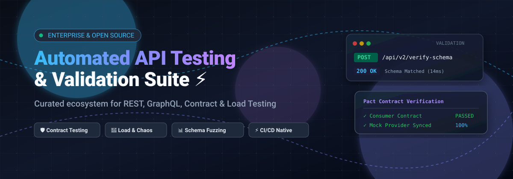
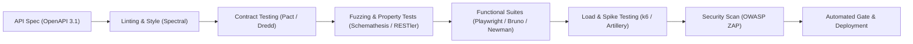

# Awesome Automated API Testing & Validation ⚡

 
 

  <b>A production-grade curated directory of leading SaaS platforms and open-source frameworks for Automated API Testing, Schema Validation, Contract Testing, Fuzzing, and CI/CD Quality Assurance.</b>

---

## 📑 Table of Contents
- [🌐 Sector Overview & Market Dynamics](#-sector-overview--market-dynamics)
- [☁️ SaaS & Enterprise Testing Platforms](#️-saas--enterprise-testing-platforms)
- [🔓 Open-Source GitHub Frameworks & Tools](#-open-source-github-frameworks--tools)
- [🛠️ Architecture & Pipeline Recommendation](#️-architecture--pipeline-recommendation)
- [🤝 How to Contribute](#-how-to-contribute)
- [💖 Support & Sponsorship](#-support--sponsorship)
- [📈 Star History](#-star-history)
- [📜 Disclaimer](#-disclaimer)

---

## 🌐 Sector Overview & Market Dynamics

The global API testing and automated quality validation market is estimated at **$1.8 billion to $2.2 billion** (projected to reach over **$4.5 billion by 2030** at a compound annual growth rate of ~18-20%). The sector is **moderately fragmented**: while a small group of enterprise giants (Microsoft, SmartBear, Postman, and Broadcom) dominate broad developer workflows and enterprise procurement, high-velocity innovation remains intensely distributed across specialized niches—such as consumer-driven contract testing, stateful schema fuzzing, AI-assisted self-healing assertions, and Git-native local clients.

---

## ☁️ SaaS & Enterprise Testing Platforms

*Sorted by company scale (Revenue / Valuation) in descending order.*

| Product 🛠️ | Company Scale (Valuation / Revenue) 🏢 | Pricing (Starting Tier) 💳 | Free Tier / Trial Limits 🎁 | Description & Core Strengths 🎯 |
| :--- | :--- | :--- | :--- | :--- |
| **[Microsoft Playwright Testing](https://playwright.dev/)** | **~$3.1 Trillion** market cap (Microsoft) | **$0.012 per test minute** (pay-as-you-go cloud runners) | **100 free test minutes/month** during initial workspace onboarding | Managed cloud-scale parallel runner service for Playwright API and E2E suites with deep Azure CI/CD integration. |
| **[BlazeMeter (Perforce)](https://www.blazemeter.com/)** | **~$9 Billion** valuation (Perforce parent) | **$99/month** (Basic plan, billed annually) | **Free tier**: 50 tests/month, max 50 concurrent virtual users, and 20-minute test run duration | Enterprise performance and API load-testing platform with JMeter compatibility and AI mock services. |
| **[Postman API Testing](https://www.postman.com/)** | **~$5.6 Billion** valuation | **$14/user/month** (Basic plan, billed annually) | **Free forever**: Up to 3 team members, 25 collection runner executions/month, and 1,000 cloud mock/monitor calls/month | Comprehensive API development and collaborative testing environment with collection automation. |
| **[ReadyAPI (SmartBear)](https://smartbear.com/product/ready-api/)** | **~$350M+ ARR** (~$2.5B+ valuation) | **$959/year** per license (~$79.91/month, Test module) | **14-day free trial**: Full access to functional, security, and load modules with up to 5 concurrent virtual users | Industry-standard commercial enterprise suite for functional, GraphQL, REST, and SOAP validation. |
| **[Cypress Cloud](https://www.cypress.io/cloud/)** | **~$500 Million** valuation | **$67/month** (Team tier, billed annually) | **Free forever**: Up to 50 test results/month, 3 users, and community support | Cloud test orchestration dashboard providing auto-cancellation, smart flake detection, and analytics. |
| **[Katalon Studio](https://katalon.com/)** | **~$100M+ Series A** / ~$40M+ ARR | **$167/month** (Premium tier, billed annually) | **Free forever plan**: 2,000 test execution results/month, 5 test authoring licenses with basic reporting | All-in-one low-code test automation platform covering REST/GraphQL API, web, and mobile environments. |
| **[Testim (Tricentis)](https://www.testim.io/)** | Tricentis acquisition (**~$500M+ ARR**) | **$450/month** (Starting tier) | **14-day free trial**: Up to 1,000 automated test executions across API and web suites | AI-driven testing platform featuring smart locators, self-healing tests, and integrated HTTP assertions. |
| **[Karate Labs](https://karatelabs.io/)** | Seed-stage VC backed (**~$10M - $25M** valuation) | **$29/user/month** (Official Studio / Team tier) | **Free tier**: Open-source runtime is unlimited; SaaS Studio provides a **14-day free trial** with full telemetry | Commercial extension and developer productivity tools built around the open-source Karate test DSL. |
| **[RestAssured (Supported)](https://rest-assured.io/)** | Boutique OSS Enterprise Services (**<$5M** revenue) | **$499/consulting block** (commercial SLA packages) | **Open-source core is 100% free**; vendor support agreements provide standard 30-day onboarding trials | Battle-tested BDD Java DSL for testing RESTful microservices, backed by ecosystem enterprise support. |
| **[Tavern (Hosted CI Runners)](https://tavern.readthedocs.io/)** | Community-led / Indie dev (**<$1M** revenue) | **$10/month** (Hosted runner credit tier) | **Free forever**: Open-source CLI is completely free; cloud orchestrators provide 200 free build minutes/month | Minimalist, declarative YAML-driven HTTP/MQTT test runner built directly upon Pytest. |

---

## 🔓 Open-Source GitHub Frameworks & Tools

*Sorted by GitHub Star count in descending order. Click any star badge to inspect live repository stargazers.*

| Project 📦 | Stars 🌟 | Primary Languages / Ecosystem 💻 | Key Features & Focus Area 🔍 |
| :--- | :--- | :--- | :--- |
| **[Playwright](https://github.com/microsoft/playwright)** |  | TypeScript, JavaScript, Python, C#, Java | High-velocity end-to-end framework featuring built-in, lightning-fast `APIRequestContext` for unified web and REST testing. |
| **[Cypress](https://github.com/cypress-io/cypress)** |  | JavaScript, TypeScript | Complete testing ecosystem with first-class `cy.request()` integration, visual command logs, and automatic waiting. |
| **[Bruno](https://github.com/usebruno/bruno)** |  | JavaScript, Electron | Fast, offline-first, Git-native Postman alternative storing API test collections as plain Bru markup files in version control. |
| **[k6](https://github.com/grafana/k6)** |  | Go, JavaScript | Modern, developer-centric load and performance testing tool for APIs, microservices, and protocols using JS test scripts. |
| **[Locust](https://github.com/locustio/locust)** |  | Python | Scalable, distributed user-load testing framework for HTTP APIs where user behavior scenarios are defined in pure Python. |
| **[Hurl](https://github.com/Orange-OpenSource/hurl)** |  | Rust | High-performance CLI tool powered by curl that executes HTTP requests defined in simple plain text with flexible assertions. |
| **[OWASP ZAP](https://github.com/zaproxy/zaproxy)** |  | Java | World’s most widely used web and REST API security scanner, ideal for automated vulnerability checks in CI/CD. |
| **[Apache JMeter](https://github.com/apache/jmeter)** |  | Java | Veteran open-source application designed to load test functional behavior and measure the performance of REST and SOAP APIs. |
| **[Artillery](https://github.com/artilleryio/artillery)** |  | JavaScript, Node.js | Cloud-scale serverless load testing and API stress framework supporting HTTP, WebSocket, GraphQL, and Playwright engines. |
| **[Karate](https://github.com/karatelabs/karate)** |  | Java, Cucumber Gherkin | Unified test automation DSL combining API functional testing, contract assertions, mocks, and performance testing into one. |
| **[WireMock](https://github.com/wiremock/wiremock)** |  | Java | Flexible API mocking and stubbing library for unit and integration tests, supporting dynamic response generation and faults. |
| **[Newman](https://github.com/postmanlabs/newman)** |  | JavaScript, Node.js | Official command-line collection runner for Postman that executes collection runs natively inside automated build pipelines. |
| **[REST Assured](https://github.com/rest-assured/rest-assured)** |  | Java | Fluent domain-specific language that brings simplicity and readability to verifying REST responses in the JVM ecosystem. |
| **[Gatling](https://github.com/gatling/gatling)** |  | Scala, Java, Kotlin | High-performance asynchronous load-testing tool providing detailed HTML metrics and code-as-configuration API tests. |
| **[MockServer](https://github.com/mock-server/mockserver)** |  | Java | Full-featured mock server and proxy for mocking HTTP/HTTPS, gRPC, and WebSockets while inspecting and validating live traffic. |
| **[Dredd](https://github.com/apiaryio/dredd)** |  | JavaScript, Node.js | Language-agnostic CLI tool for contract validation that checks API backend responses against OpenAPI and API Blueprint specs. |
| **[Schemathesis](https://github.com/schemathesis/schemathesis)** |  | Python | State-of-the-art property-based testing tool that reads OpenAPI / GraphQL schemas and synthesizes thousands of negative test cases. |
| **[Kin OpenAPI](https://github.com/getkin/kin-openapi)** |  | Go | Extensive Go library for parsing, validating, and checking requests/responses against OpenAPI 3.0 and 3.1 specifications. |
| **[Spectral](https://github.com/stoplightio/spectral)** |  | TypeScript, JavaScript | Flexible JSON/YAML linter for enforcing API style guides, schema standards, and security lint rules across OpenAPI specifications. |
| **[RESTler](https://github.com/microsoft/restler-fuzzer)** |  | C#, Python | Microsoft’s stateful REST API fuzzer that analyzes OpenAPI specs to automatically infer dependencies and detect crash bugs. |
| **[Microcks](https://github.com/microcks/microcks)** |  | Java, Go, TypeScript | Cloud Native Computing Foundation (CNCF) incubating project for API mocking and contract testing for REST, GraphQL, and AsyncAPIs. |
| **[Step CI](https://github.com/stepci/stepci)** |  | TypeScript, JavaScript | Modern, open-source automated API quality framework supporting functional, load, and security testing in simple YAML manifests. |
| **[Pact](https://github.com/pact-foundation/pact-js)** |  | TypeScript, JavaScript | Polyglot consumer-driven contract testing tool enabling safe microservice deployment by verifying contract agreements before deployment. |
| **[SoapUI Open Source](https://github.com/SmartBear/soapui)** |  | Java | Established desktop tool for functional, schema inspection, and regression testing across RESTful and legacy SOAP endpoints. |
| **[Tavern](https://github.com/taverntesting/tavern)** |  | Python | Concise, test-runner framework and Pytest plugin for testing RESTful, GraphQL, and IoT/MQTT services with human-readable YAML. |
| **[Express OpenAPI Validator](https://github.com/cdimascio/express-openapi-validator)** |  | TypeScript, JavaScript | Middleware that automatically validates API requests, responses, and authorization parameters directly against OpenAPI specs. |
| **[Newman HTML Extra Reporter](https://github.com/DannyDainton/newman-reporter-htmlextra)** |  | JavaScript | Highly customizable, interactive HTML dashboard reporter for Newman collection runs with breakdown stats and error callouts. |

---

## 🛠️ Architecture & Pipeline Recommendation

For teams establishing a robust, vendor-neutral automated API validation pipeline in CI/CD:

---

## 🤝 How to Contribute

We actively welcome contributions to keep this ecosystem accurate and up-to-date!

1. 🍴 **Fork the repository** on GitHub.
2. 🌿 **Create a feature branch**: `git checkout -b feature/add-new-tool`
3. 📝 **Add or update an entry**: Ensure the company scale, precise starting pricing tier, specific free tier limits, and GitHub links are verified.
4. ✨ **Commit your changes**: `git commit -m "Add NewTool to API validation directory"`
5. 🚀 **Push to the branch**: `git push origin feature/add-new-tool`
6. 📬 **Submit a Pull Request** with a brief summary of the added framework.

---

## 💖 Support & Sponsorship

If you find this automated API testing and validation directory useful, please consider supporting the project:

- ⭐ **Star this repository** to help other engineers and QA teams discover it.
- 🍴 **Fork and share** it with your developer and QA communities.
- ☕ **Sponsor or buy a coffee**: Support ongoing curation and maintenance via the [GitHub Sponsors Dashboard](https://github.com/sponsors/ishandutta2007).

Your support keeps this directory open, unbiased, and continuously updated!

---

## 📈 Star History

---

## 📜 Disclaimer

- This repository is a community-curated, educational directory; mentions do not constitute official endorsement.
- All product names, logos, and brands are property of their respective owners.
- Automated API testing tools and fuzzers must be used strictly in adherence with applicable authorization, security policies, and data privacy regulations.
